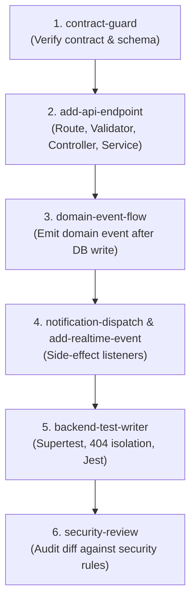

# SyncMate Backend Antigravity Skills

This directory contains the custom Antigravity Skills developed specifically for the SyncMate backend (Node.js + Express ES Modules, Mongoose, Socket.IO).

---

## Skills Index & Trigger Reference

| # | Skill Name | Path | Trigger Phrases / Scenarios | Primary Output & Capability |
|---|---|---|---|---|
| 1 | **`contract-guard`** | [`.agent/skills/contract-guard/SKILL.md`](file:///c:/Users/prakh/OneDrive/Desktop/projects/.agent/skills/contract-guard/SKILL.md) | "modify API", "new endpoint", "check contract", "verify route", "change schema" | Verifies endpoints against `API_CONTRACT.md`; includes `diff-contract.js`. |
| 2 | **`add-api-endpoint`** | [`.agent/skills/add-api-endpoint/SKILL.md`](file:///c:/Users/prakh/OneDrive/Desktop/projects/.agent/skills/add-api-endpoint/SKILL.md) | "add endpoint", "new route", "create API", "implement route", "POST / PATCH endpoint" | Strict route -> zod -> controller -> service -> serializer -> test pipeline. |
| 3 | **`domain-event-flow`** | [`.agent/skills/domain-event-flow/SKILL.md`](file:///c:/Users/prakh/OneDrive/Desktop/projects/.agent/skills/domain-event-flow/SKILL.md) | "domain event", "event bus", "add listener", "event wiring", "side effect" | Decouples business logic from notifications, sockets, activities, and sync. |
| 4 | **`add-realtime-event`** | [`.agent/skills/add-realtime-event/SKILL.md`](file:///c:/Users/prakh/OneDrive/Desktop/projects/.agent/skills/add-realtime-event/SKILL.md) | "socket event", "realtime", "Socket.IO", "emit realtime", "broadcast event" | Broadcasts base DTOs to `group:<gid>` and `user:<uid>` rooms with integration tests. |
| 5 | **`reminder-scheduler`** | [`.agent/skills/reminder-scheduler/SKILL.md`](file:///c:/Users/prakh/OneDrive/Desktop/projects/.agent/skills/reminder-scheduler/SKILL.md) | "reminder", "scheduler", "cron", "fireAt", "reminder job", "recompute reminders" | Per-user reminders, atomic cron claiming, exactly-once delivery, and clock tests. |
| 6 | **`notification-dispatch`** | [`.agent/skills/notification-dispatch/SKILL.md`](file:///c:/Users/prakh/OneDrive/Desktop/projects/.agent/skills/notification-dispatch/SKILL.md) | "notification", "push token", "FCM", "email alert", "notify users", "dispatch notification" | In-app DB records, FCM push, and SMTP email with actor exclusion. |
| 7 | **`hackathon-and-watchlist`** | [`.agent/skills/hackathon-and-watchlist/SKILL.md`](file:///c:/Users/prakh/OneDrive/Desktop/projects/.agent/skills/hackathon-and-watchlist/SKILL.md) | "hackathon", "watchlist", "pin", "participation", "primaryUrl", "save for later" | Hackathon metadata validation, `primaryUrl` virtuals, pin privacy, and statuses. |
| 8 | **`google-calendar-sync`** | [`.agent/skills/google-calendar-sync/SKILL.md`](file:///c:/Users/prakh/OneDrive/Desktop/projects/.agent/skills/google-calendar-sync/SKILL.md) | "google calendar", "google sync", "oauth callback", "calendar integration", "reconcile calendar" | AES-256-GCM token encryption, duplicate-prevention via extendedProperties, sync engine. |
| 9 | **`backend-test-writer`** | [`.agent/skills/backend-test-writer/SKILL.md`](file:///c:/Users/prakh/OneDrive/Desktop/projects/.agent/skills/backend-test-writer/SKILL.md) | "write test", "integration test", "jest test", "test suite", "unit test" | Supertest + in-memory Mongo test suites covering happy paths, 404 leaks, and validation. |
| 10 | **`seed-and-demo-data`** | [`.agent/skills/seed-and-demo-data/SKILL.md`](file:///c:/Users/prakh/OneDrive/Desktop/projects/.agent/skills/seed-and-demo-data/SKILL.md) | "seed", "seed data", "demo data", "populate db", "reset database" | Idempotent seed script for 4 demo personas, group `DEMO1234`, and SIH 2026. |
| 11 | **`security-review`** | [`.agent/skills/security-review/SKILL.md`](file:///c:/Users/prakh/OneDrive/Desktop/projects/.agent/skills/security-review/SKILL.md) | "security", "security review", "audit code", "check vulnerability", "security audit" | Audits code against rate limiting, auth guards, injection, and secret leakage. |
| * | **`instant-skill-and-web-search`** | [`.agent/skills/instant-skill-and-web-search/SKILL.md`](file:///c:/Users/prakh/OneDrive/Desktop/projects/.agent/skills/instant-skill-and-web-search/SKILL.md) | "need skill", "create skill", "search web", "missing docs" | Auto-generates specialized skills just-in-time and performs web searches. |

---

## Recommended Order of Use

When developing a new feature or endpoint, follow this chained execution workflow:

1. **`contract-guard`**: Confirm route, method, params, and response shape in `API_CONTRACT.md`.
2. **`add-api-endpoint`**: Implement Zod validator -> route -> controller -> service -> serializer.
3. **`domain-event-flow`**: Emit event from service to decouple side effects.
4. **`add-realtime-event`** & **`notification-dispatch`**: Broadcast to Socket.IO rooms and push notifications.
5. **`backend-test-writer`**: Write Supertest suite covering happy path, 404 cross-group check, and validation errors.
6. **`security-review`**: Audit diff for secret leakage, rate limiting, and parameter validation.

