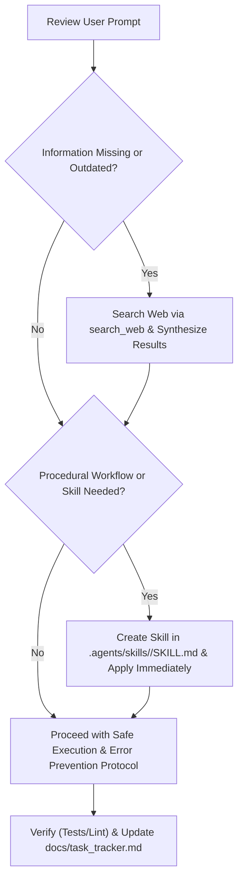

# Dynamic Skill Creation & Web Research Protocol

This skill enables the agent to dynamically extend its own capabilities on the fly whenever a task requires specialized procedural workflows, and to conduct web research to fill information gaps before taking action.

---

## 1. Just-In-Time Skill Creation

### When to Create a New Skill
Create a skill immediately if:
- The task requires a multi-step procedure, tool workflow, or complex pattern that will be repeated or needs strict step-by-step guidance.
- Domain-specific setup, testing, or deployment routines are needed (e.g., database migration flows, socket testing, OAuth verification).
- The existing skill library does not already cover the required workflow.

### How to Create & Use the Skill Instantly
1. **Determine the Skill Identifier**:
   - Choose a clear, lowercase, hyphenated name (e.g., `google-calendar-sync-verifier`, `socketio-testing-workflow`).
2. **Create the Skill File**:
   - Write to `.agents/skills/<skill-name>/SKILL.md`.
   - Include required YAML frontmatter:
     ```yaml
     ---
     name: <skill-name>
     description: <Third-person description stating what it does and when to use it>
     ---
     ```
   - Provide concrete, actionable steps, code examples, verification checks, and references.
3. **Activate & Use Immediately**:
   - Read the newly created skill or execute its steps directly in the ongoing task.
   - Record the newly created skill in [`docs/task_tracker.md`](file:///c:/Users/prakh/OneDrive/Desktop/projects/docs/task_tracker.md).

---

## 2. Web Research Protocol (Information Gap Resolution)

### When to Search the Web
Perform a web search immediately if:
- API documentation, library signatures, or integration specs are uncertain or may have changed.
- Documentation for a third-party service (e.g., Google OAuth 2.0, FCM Push API, Socket.IO client-server compatibility) is incomplete or not present in local docs.
- A runtime error or deprecation notice is encountered that is not explained by the codebase.

### Execution Protocol
1. **Formulate Targeted Queries**:
   - Use precise search keywords (e.g., `"Socket.io v4 express auth handshake"`, `"googleapis calendar events insert v3 nodejs"`).
2. **Synthesize & Validate Findings**:
   - Cross-check against the project's existing constraints (e.g., Node.js ES Modules, dependencies in `package.json`).
   - Do NOT blindly paste deprecated code snippets or outdated StackOverflow patterns.
3. **Document Findings in Tracker**:
   - Note the resolved pattern or official API reference in [`docs/task_tracker.md`](file:///c:/Users/prakh/OneDrive/Desktop/projects/docs/task_tracker.md).

---

## 3. Workflow Integration Loop



