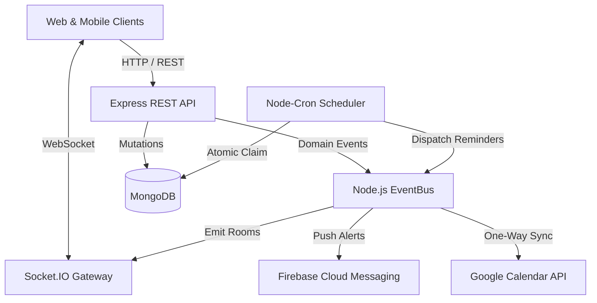

# SyncMate Backend

SyncMate is a production-grade shared group calendar API for small teams (3–5 people) with real-time Socket.IO synchronization, rich hackathon metadata, multi-channel reminders, watchlist pins, and one-way Google Calendar integration.

---

## 🏗️ Architecture Overview



---

## ⚡ Quick Start

### 1. Prerequisites
- **Node.js**: `v20.x` or higher
- **MongoDB**: `v7.x` or higher (local or MongoDB Atlas)

### 2. Install Dependencies
```bash
npm install
```

### 3. Environment Variables
Copy `.env.example` to `.env` or set the following variables:

```bash
PORT=5000
NODE_ENV=development
MONGO_URI=mongodb://localhost:27017/syncmate
WEB_URL=http://localhost:5173
CORS_ORIGINS=http://localhost:5173
JWT_ACCESS_SECRET=your_jwt_access_secret_min_32_characters_long
JWT_REFRESH_SECRET=your_jwt_refresh_secret_min_32_characters_long
ENCRYPTION_KEY=0123456789abcdef0123456789abcdef0123456789abcdef0123456789abcdef
```

### 4. Seed the Database
Populate MongoDB with 4 demo personas (`alex@demo.com`, `sam@demo.com`, `priya@demo.com`, `rahul@demo.com` with password `Demo@1234`), group `Team Alpha` (invite code `DEMO1234`), and 25 realistic events including SIH 2026:

```bash
npm run seed
```

### 5. Start the Server
```bash
# Development mode with hot-reload
npm run dev

# Production mode
npm start
```

---

## 🧪 Testing & Code Quality

The backend features a comprehensive automated test suite (Jest + Supertest + in-memory MongoDB):

```bash
# Run all 12 test suites (135 tests)
npm test

# Run ESLint across entire codebase
npm run lint

# Format code with Prettier
npm run format
```

---

## 📜 Available NPM Scripts

| Command | Description |
| :--- | :--- |
| `npm start` | Launches production server on `src/server.js` |
| `npm run dev` | Launches dev server with `nodemon` hot reloading |
| `npm test` | Runs Jest integration test suite in-band with open handles detection |
| `npm run lint` | Runs ESLint 9 across all source and test files |
| `npm run format` | Auto-formats code with Prettier |
| `npm run seed` | Idempotent database seeder creating demo personas and SIH 2026 |

---

## 🔑 Environment Configuration Table

| Variable | Default / Example | Purpose |
| :--- | :--- | :--- |
| `PORT` | `5000` | HTTP listening port |
| `NODE_ENV` | `development` | Runtime environment (`development`, `production`, `test`) |
| `MONGO_URI` | `mongodb://localhost:27017/syncmate` | MongoDB connection string |
| `WEB_URL` | `http://localhost:5173` | Web frontend URL for deep linking and redirects |
| `CORS_ORIGINS` | `http://localhost:5173` | Comma-separated list of allowed origins |
| `JWT_ACCESS_SECRET` | *required* (≥32 chars) | HMAC secret for signing access JWTs (15m TTL) |
| `JWT_REFRESH_SECRET` | *required* (≥32 chars) | HMAC secret for signing refresh JWTs (30d TTL) |
| `ENCRYPTION_KEY` | *required* (64 hex chars) | 32-byte AES-256-GCM key for encrypting Google refresh tokens |
| `DISABLE_SCHEDULER` | `false` | Disable background cron workers during unit testing |
| `GOOGLE_CLIENT_ID` | *optional* | Google Cloud OAuth 2.0 Web Client ID |
| `GOOGLE_CLIENT_SECRET` | *optional* | Google Cloud OAuth 2.0 Client Secret |
| `GOOGLE_REDIRECT_URI` | `http://localhost:5000/api/v1/integrations/google/callback` | OAuth redirect URI |
| `FIREBASE_SERVICE_ACCOUNT_JSON` | *optional* | Service account JSON string for FCM push notifications |
| `SMTP_HOST` | *optional* | SMTP server hostname for email alerts |
| `SMTP_PORT` | `587` | SMTP server port |
| `SMTP_USER` | *optional* | SMTP authentication username |
| `SMTP_PASS` | *optional* | SMTP authentication password |

---

## 🌐 External Integrations

### 1. Google Calendar Integration
- **OAuth Scopes**: `https://www.googleapis.com/auth/calendar.events`, `openid`, `email`
- **Duplicate Prevention Guarantee**: All Google events carry `extendedProperties.private.syncmateEventId`. SyncMate queries Google Calendar before inserting to prevent duplicate events across resyncs.
- **Nightly Reconciliation**: Background job runs at `03:00 Asia/Kolkata` ensuring parity and pruning orphaned records.

### 2. Multi-channel Notifications
- **In-App**: Stored in MongoDB with unread tracking and 90-day TTL.
- **Push**: Dispatched via Firebase Cloud Messaging multicast to registered device tokens. Tokens are auto-pruned upon unregistration.
- **Email**: Dispatched via Nodemailer when user preference `settings.emailNotifications` is enabled.

---

## 🐳 Docker Deployment

Build and run the entire stack (API + MongoDB) locally or on cloud servers:

```bash
docker-compose up --build
```

Health check is accessible at `http://localhost:5000/health`.
API documentation is defined in [`openapi.yaml`](file:///c:/Users/prakh/OneDrive/Desktop/projects/openapi.yaml).
Full contract specifications are defined in [`syncmate-backend-instructions/API_CONTRACT.md`](file:///c:/Users/prakh/OneDrive/Desktop/projects/syncmate-backend-instructions/API_CONTRACT.md).
