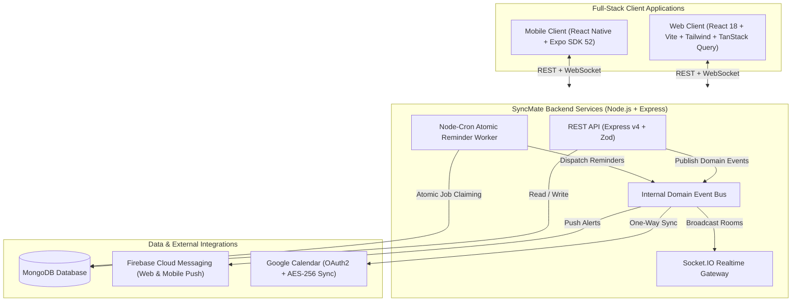

# SyncMate — Full-Stack Shared Team Calendar & Hackathon Tracker

[](https://github.com/prakharahuja12/syncmate)
[](https://www.typescriptlang.org/)
[](LICENSE)

**SyncMate** is a production-grade shared calendar platform designed for small teams (3–5 people) participating in hackathons and coordinating academic and group milestones. It features instant real-time synchronization, rich hackathon metadata with direct registration links, a team watchlist with participant status tallying, multi-channel reminders, and safe one-way Google Calendar integration.

---

## 🏛️ System Architecture



---

## 📂 Repository Structure

```
syncmate/
├── src/                         # Backend Server (Node.js, Express, Socket.IO, Mongoose)
│   ├── config/                  # Environment, DB, and OAuth configurations
│   ├── controllers/             # REST controllers (Auth, Groups, Events, Watchlist, etc.)
│   ├── jobs/                    # Atomic cron scheduler & reminder worker
│   ├── listeners/               # EventBus decoupled handlers (Socket, Push, Google sync)
│   ├── middleware/              # Auth guards, group tenancy, rate limiting, error handling
│   ├── models/                  # Mongoose models (User, Group, Event, Pin, Participation, etc.)
│   ├── routes/                  # Express route declarations adhering to API_CONTRACT.md
│   ├── seed/                    # Idempotent demo database seeder
│   ├── services/                # Business logic engines (Google sync, Push, Reminders)
│   └── utils/                   # Crypto (AES-256-GCM), serializers, and date math
├── web/                         # Modern Web Application (React 18 + Vite + Tailwind CSS)
│   ├── src/
│   │   ├── components/          # Design system components (Sidebar, Topbar, BottomNav, UI)
│   │   ├── features/            # Feature slices (Auth, Group, Calendar, Dashboard, Watchlist)
│   │   ├── lib/                 # Axios client with refresh queue, Socket.IO, dates
│   │   ├── stores/              # Zustand state stores (authStore, uiStore)
│   │   └── types/               # Strict TypeScript definitions from API_CONTRACT.md
│   └── __tests__/               # Vitest unit test suite (13 tests)
├── mobile/                      # Mobile Application (React Native + Expo SDK 52)
│   ├── src/
│   │   ├── components/          # Mobile atomic components (Safe areas, Cards, Buttons)
│   │   ├── features/            # Screens (Calendar, Watchlist, Notifications, Settings)
│   │   ├── lib/                 # SecureStore tokens, Axios queue, Socket.IO, Push channels
│   │   ├── navigation/          # React Navigation v7 stacks and bottom tabs
│   │   └── theme/               # Light/dark tokens, haptics, and responsive layout
│   └── __tests__/               # Mobile Jest unit tests (18 tests)
├── tests/                       # Backend Integration Tests (Jest + Supertest + in-memory Mongo)
└── docs/                        # Specifications, Context Ledger, and Task Tracker
```

---

## ⚡ Quick Start & Running Locally

### 1. Prerequisites
- **Node.js**: `v20.x` or higher
- **MongoDB**: `v7.x` or higher (local service or MongoDB Atlas)
- **Expo Go** (optional, for testing on physical mobile devices)

### 2. Install Dependencies
```bash
# Install backend dependencies
npm install

# Install web client dependencies
npm run --prefix web install

# Install mobile client dependencies
npm run --prefix mobile install
```

### 3. Environment Setup
Create a `.env` file in the root directory:
```env
PORT=5000
NODE_ENV=development
MONGO_URI=mongodb://localhost:27017/syncmate
WEB_URL=http://localhost:5173
CORS_ORIGINS=http://localhost:5173
JWT_ACCESS_SECRET=your_jwt_access_secret_min_32_characters_long
JWT_REFRESH_SECRET=your_jwt_refresh_secret_min_32_characters_long
ENCRYPTION_KEY=0123456789abcdef0123456789abcdef0123456789abcdef0123456789abcdef
```

### 4. Seed the Database
Populate the database with 4 demo personas, group `DEMO1234`, and realistic hackathons (SIH 2026):
```bash
npm run seed
```

**Demo Credentials**:
- **Email**: `alex@demo.com` (also `priya@demo.com`, `sam@demo.com`, `rahul@demo.com`)
- **Password**: `Demo@1234`
- **Group Code**: `DEMO1234`

### 5. Start Development Servers
You can run each tier individually or together:

```bash
# Start backend API (http://localhost:5000)
npm run dev:backend

# Start web client (http://localhost:5173)
npm run dev:web

# Start mobile client (Metro bundler / Expo Go)
npm run dev:mobile
```

---

## 🐳 Docker Deployment

Run the complete backend stack with MongoDB using Docker Compose:

```bash
docker-compose up --build
```

---

## 🧪 Comprehensive Test Suite (166 Tests Passing)

SyncMate is thoroughly covered with hermetic automated tests across all tiers:

```bash
# Run all tests across the entire monorepo (166 tests)
npm run test:all

# Or run tests per component:
npm run test:backend   # 12 suites, 135 tests passed
npm run test:web       # 3 suites, 13 tests passed
npm run test:mobile    # 3 suites, 18 tests passed

# Verify strict TypeScript across web and mobile (0 errors)
npm run typecheck:all
```

---

## 📄 License
MIT © [Prakhar Ahuja](https://github.com/prakharahuja12)
